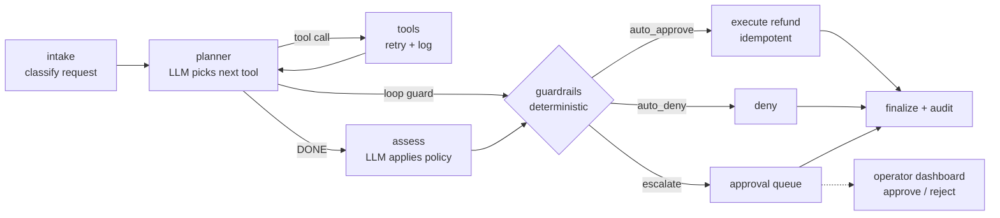

# ResolveAI

An autonomous customer-refund agent. It investigates each request with tools, applies the refund policy, and either resolves the case itself or escalates risky ones to a human operator. Every step is logged and measured against a labeled eval set.

**Core idea:** the LLM *investigates and recommends*; deterministic code *decides* whether money can move without a human.

## Architecture



| Piece | Where | What it does |
|---|---|---|
| State machine | `resolveai/graph.py` | LangGraph `StateGraph`: intake → plan ⇄ tools → assess → guardrails → execute / deny / escalate → finalize |
| Tools | `resolveai/tools.py` | `lookup_order`, `get_customer_history`, `run_fraud_check`, `search_refund_policy`, `create_refund` over SQLite |
| Guardrails | `resolveai/guardrails.py` | Hard limits: >$200, fraud ≥ 0.70, 3+ refunds in 30 days, new account >$50, low confidence, missing evidence |
| Short-term memory | graph state | Evidence, tool-call history and step count carried across nodes; checkpointed per case (`thread_id`) |
| Loop protection | `planner` node | Max 10 steps, max 2 identical calls, disallowed-tool detection, plus a graph recursion limit |
| Retries | `ToolRuntime.call` | 2 retries with exponential backoff; fault injection (8% transient errors, 1.5% per-case outages) |
| Audit log | `audit_log` table | Every tool attempt, plan step, recommendation, guardrail verdict, escalation, human decision, outcome |
| HITL dashboard | `dashboard/app.py` | Streamlit approval queue, case explorer with full traces, eval metrics |
| Eval | `resolveai/evaluate.py` | 200 labeled cases across 21 scenarios |

### Safety design (good interview material)

- **The LLM can't move money.** `create_refund` isn't in the planner's tool list. If the model asks for it anyway, the loop guard trips and the case escalates (see `RogueLLM` in the tests).
- **Policy vs. risk are separated.** The LLM applies the written policy (eligibility, amount); code enforces risk limits it can't override, however confident it is.
- **Fails safe.** If a tool is down after retries, refunds are blocked (escalate) but clear denials can still be automated.
- **Idempotent refunds.** Keyed on `case_id`, so retries or a double-click in the dashboard can't pay twice.
- **Data minimization.** `lookup_order` won't reveal another customer's order details on an ownership mismatch.

## Quickstart

```bash
pip install -r requirements.txt

python scripts/run_eval.py             # builds the synthetic world, runs all 200 cases, writes reports/
streamlit run dashboard/app.py         # approve/reject the escalations
python scripts/run_case.py CASE-0023   # step-by-step trace of one case
python -m pytest -q                    # 17 tests: guardrails, retries, idempotency, loop guards, HITL
```

### Use a real LLM

```bash
pip install anthropic
export ANTHROPIC_API_KEY=...
export LLM_PROVIDER=anthropic          # model via ANTHROPIC_MODEL, default claude-haiku-5-5
python scripts/run_eval.py --limit 50  # start small, check cost
```

OpenAI works too: `LLM_PROVIDER=openai OPENAI_MODEL=<model>`. Set `PRICE_IN_PER_MTOK` / `PRICE_OUT_PER_MTOK` to your model's real pricing so cost metrics are accurate.

The default `mock` provider is a deterministic **keyword baseline**: keyword intent classifier, fixed evidence plan, and policy rules. It runs offline and reproducibly, so it's the floor your LLM run should beat.

## Eval

`datagen.py` builds a synthetic store and 200 tickets. Each scenario has a ground-truth label (approve with an exact amount, deny, or escalate) decided from the written policy. About 30% of messages are phrased indirectly ("ordered black, got navy", "a piece snapped right off") so the eval tests language understanding, not keyword matching.

**Baseline results (mock provider, seed 42):**

| Metric | Value |
|---|---|
| Autonomous resolution rate | 48.0% (ceiling is 64.5%; 35.5% of cases *should* escalate) |
| Decision accuracy | 83.5% |
| Escalation recall / precision | 100% / 68.3% |
| **Unsafe auto-approvals** | **0** |
| Refund amount accuracy | 100% |
| Tool success: first try → after retries | 92.2% → 99.5% (70 retries) |
| Avg steps per case | 5 planner steps, 4 tool calls |
| Latency p50 / p95 | 336 / 686 ms (simulated tool latency only) |

Every baseline miss is a *safe* miss: an over-escalation on an indirectly phrased message. For example, CASE-0023 ("a piece snapped right off") is classified `unknown`, so it goes to a human. Closing that gap is exactly what the LLM is for, and the guardrails make sure a smarter model can't make the system less safe.

See `reports/eval_report.md` for the confusion matrix and per-scenario breakdown.

## Project layout

```
resolveai/
  config.py          thresholds, limits, provider, fault rates
  db.py              SQLite schema + audit logger
  policy.md          the refund policy the agent searches
  tools.py           tool implementations, retries, fault injection
  guardrails.py      auto vs. escalate rules
  llm.py             MockLLM baseline, AnthropicLLM, OpenAILLM + prompts
  graph.py           LangGraph agent
  approvals.py       human approve/reject
  datagen.py         synthetic world + labeled scenarios
  evaluate.py        metrics + reports
  _langgraph_compat.py  tiny fallback used only if langgraph isn't installed
scripts/  run_eval.py, run_case.py
dashboard/app.py
tests/test_agent.py
```

## Resume

Run with a real model first and plug in *those* numbers:

- Built **ResolveAI**, an agentic refund-resolution system in **LangGraph** with 5 tools (order lookup, policy search, customer history, fraud check, refunds) and a stateful plan → gather → assess → act workflow.
- Separated LLM reasoning from **deterministic risk guardrails** and **human-in-the-loop approvals** (Streamlit). The system autonomously resolved **X%** of 200 labeled cases with **0 unsafe auto-approvals** and **Y% escalation recall**.
- Hardened the agent with retries plus exponential backoff (tool success **92% → 99.5%** under injected faults), loop detection, idempotent refund execution, and full audit logging. Benchmarked accuracy, steps, latency (p95 **Z ms**) and cost (**$W/case**) against a keyword baseline.
